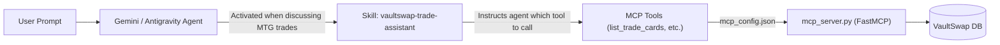

# How to Set Up the VaultSwap Trade MCP & Gemini Skill

This guide explains how to connect Gemini / Antigravity to the **VaultSwap Trade MCP Server** and activate the custom skill.

---

## 1. How the Architecture Works



1. **MCP Server (`mcp_server.py`)**: Runs locally and exposes the tools (`list_trade_cards`, `get_trade_card_metadata`, `list_pod_traders`, `get_pod_trade_summary`) over standard I/O (`stdio`).
2. **MCP Config (`mcp_config.json`)**: Tells Gemini how to launch the MCP server executable.
3. **Skill (`SKILL.md`)**: Teaches Gemini *when* and *how* to invoke those tools (playbooks for searching cards, comparing printings, and checking Mighty Meeple buylist snapshots).

---

## 2. Step 1: Register the MCP Server in Gemini

To make the tools callable by Gemini across all sessions, add the server to your Gemini config.

### Global Configuration (Recommended)
Edit `C:\Users\jpmcl\.gemini\config\mcp_config.json`:

```json
{
  "mcpServers": {
    "vaultswap-trades": {
      "command": "C:\\Users\\jpmcl\\Python Development\\.venv\\Scripts\\python.exe",
      "args": ["C:\\Users\\jpmcl\\Python Development\\VaultSwap\\mcp_server.py"]
    }
  }
}
```

> [!TIP]
> You can also place this in your project root at `.agents/mcp_config.json` if you prefer project-local scoping.

---

## 3. Step 2: Set Up the Skill

The skill instruction file has been placed in your workspace at:
👉 **[SKILL.md](file:///c:/Users/jpmcl/Python%20Development/VaultSwap/.agents/skills/vaultswap-trade-assistant/SKILL.md)**

### Directory Structure
```text
c:\Users\jpmcl\Python Development\VaultSwap\
└── .agents\
    └── skills\
        └── vaultswap-trade-assistant\
            └── SKILL.md
```

### What's Inside `SKILL.md`:
- **Trigger**: Activates automatically whenever the user asks about MTG pod trades, card availability, pricing, or buylist values.
- **Tool Mapping**: Directs Gemini to use:
  - `list_trade_cards` to browse and filter cards.
  - `get_trade_card_metadata` to look up individual cards, cross-printing alternatives, and Mighty Meeple quotes.
  - `list_pod_traders` to find trade partners and binder sizes.
  - `get_pod_trade_summary` for high-level pod trade stats.
- **Best Practices**: Ensures `meeple_bound` cards surface with priority (cards about to leave the pod) and reinforces private binder privacy.

---

## 4. Step 3: Verifying the Setup

1. **Verify MCP Execution**:
   Run the test command in PowerShell to verify the server runs smoothly:
   ```powershell
   & "..\.venv\Scripts\python.exe" mcp_server.py --help
   ```
2. **Restart Gemini / Antigravity Session**:
   Once `mcp_config.json` is saved, reload or start a new conversation.
3. **Ask Natural Language Questions**:
   You can now ask questions like:
   - *"What cards are currently up for trade in the pod?"*
   - *"Does anyone have a Rhystic Study or Cyclonic Rift for trade?"*
   - *"Who has cards marked for the Mighty Meeple buylist?"*
   - *"Show me all foil cards available for trade over $10."*
